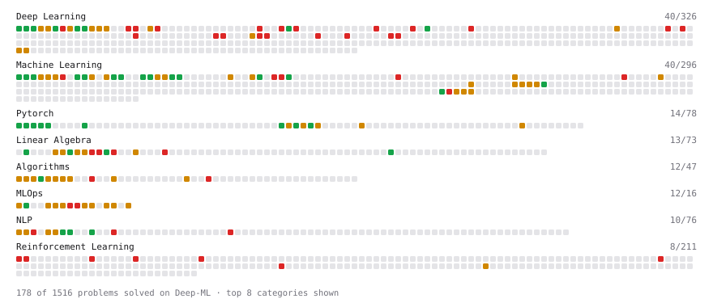

# Deep-ML

My machine learning practice from [Deep-ML](https://www.deep-ml.com). Every solution here was written by hand.

**352** solved · 339 problems · 3 labs · 10 math

[**Browse the interactive portfolio**](https://MobeenFatimaa.github.io/deep-ml/) to replay this filling in over time.

## Problems

| | Difficulty | Solved | |
| --- | --- | --- | --- |
| [Add a Bias Vector to a Batch via Broadcasting](https://www.deep-ml.com/problems/882) | easy | 2026-09-15 | [solution](problems/0882-add-a-bias-vector-to-a-batch-via-broadcasting) |
| [Add a Per-Group Average Column with GroupBy Transform](https://www.deep-ml.com/problems/1136) | easy | 2026-09-28 | [solution](problems/1136-add-a-per-group-average-column-with-groupby-transform) |
| [Apply Zero Padding to an Image](https://www.deep-ml.com/problems/239) | easy | 2026-10-06 | [solution](problems/0239-apply-zero-padding-to-an-image) |
| [Auto-Sized MLP from Gym Spaces](https://www.deep-ml.com/problems/673) | easy | 2026-10-25 | [solution](problems/0673-auto-sized-mlp-from-gym-spaces) |
| [Backprop a Linear Layer by Hand](https://www.deep-ml.com/problems/898) | easy | 2026-09-18 | [solution](problems/0898-backprop-a-linear-layer-by-hand) |
| [Balance Dataset via Undersampling](https://www.deep-ml.com/problems/1057) | easy | 2026-10-14 | [solution](problems/1057-balance-dataset-via-undersampling) |
| [Batch Iterator for Dataset](https://www.deep-ml.com/problems/30) | easy | 2026-10-02 | [solution](problems/0030-batch-iterator-for-dataset) |
| [Calculate 2x2 Matrix Inverse](https://www.deep-ml.com/problems/8) | easy | 2026-09-19 | [solution](problems/0008-calculate-2x2-matrix-inverse) |
| [Calculate Accuracy Score](https://www.deep-ml.com/problems/36) | easy | 2026-10-03 | [solution](problems/0036-calculate-accuracy-score) |
| [Calculate Covariance Matrix](https://www.deep-ml.com/problems/10) | easy | 2026-09-25 | [solution](problems/0010-calculate-covariance-matrix) |
| [Calculate Image Brightness](https://www.deep-ml.com/problems/70) | easy | 2026-10-06 | [solution](problems/0070-calculate-image-brightness) |
| [Calculate Mean Absolute Error (MAE)](https://www.deep-ml.com/problems/93) | easy | 2026-10-04 | [solution](problems/0093-calculate-mean-absolute-error-mae) |
| [Calculate Model Inference Statistics for Monitoring](https://www.deep-ml.com/problems/248) | easy | 2026-10-01 | [solution](problems/0248-calculate-model-inference-statistics-for-monitoring) |
| [Calculate Perplexity for Language Models](https://www.deep-ml.com/problems/320) | easy | 2026-09-29 | [solution](problems/0320-calculate-perplexity-for-language-models) |
| [Calculate Root Mean Square Error (RMSE)](https://www.deep-ml.com/problems/71) | easy | 2026-10-20 | [solution](problems/0071-calculate-root-mean-square-error-rmse) |
| [Calculate Unigram Probability from Corpus](https://www.deep-ml.com/problems/129) | easy | 2026-09-29 | [solution](problems/0129-calculate-unigram-probability-from-corpus) |
| [Compute a Gradient with PyTorch Autograd](https://www.deep-ml.com/problems/884) | easy | 2026-09-15 | [solution](problems/0884-compute-a-gradient-with-pytorch-autograd) |
| [Compute Multi-class Cross-Entropy Loss](https://www.deep-ml.com/problems/134) | easy | 2026-09-14 | [solution](problems/0134-compute-multi-class-cross-entropy-loss) |
| [Convert RGB Image to Grayscale](https://www.deep-ml.com/problems/237) | easy | 2026-10-06 | [solution](problems/0237-convert-rgb-image-to-grayscale) |
| [Create a Float Tensor from a Python List](https://www.deep-ml.com/problems/880) | easy | 2026-09-15 | [solution](problems/0880-create-a-float-tensor-from-a-python-list) |
| [Derivatives of Activation Functions](https://www.deep-ml.com/problems/217) | easy | 2026-09-14 | [solution](problems/0217-derivatives-of-activation-functions) |
| [Descriptive Statistics Calculator](https://www.deep-ml.com/problems/78) | easy | 2026-10-20 | [solution](problems/0078-descriptive-statistics-calculator) |
| [Exact Match Score with Normalization](https://www.deep-ml.com/problems/325) | easy | 2026-09-29 | [solution](problems/0325-exact-match-score-with-normalization) |
| [Feature Scaling Implementation](https://www.deep-ml.com/problems/16) | easy | 2026-09-27 | [solution](problems/0016-feature-scaling-implementation) |
| [Generate a Confusion Matrix for Binary Classification](https://www.deep-ml.com/problems/75) | easy | 2026-10-20 | [solution](problems/0075-generate-a-confusion-matrix-for-binary-classification) |
| [Grayscale Image Contrast Calculator](https://www.deep-ml.com/problems/82) | easy | 2026-10-06 | [solution](problems/0082-grayscale-image-contrast-calculator) |
| [Hamming Distance for Kanerva Coding](https://www.deep-ml.com/problems/647) | easy | 2026-09-24 | [solution](problems/0647-hamming-distance-for-kanerva-coding) |
| [Handle Missing Data in pandas (dropna/fillna)](https://www.deep-ml.com/problems/1128) | easy | 2026-09-28 | [solution](problems/1128-handle-missing-data-in-pandas-dropna-fillna) |
| [Implement a Linear Layer Forward Pass with Matrix Multiplication](https://www.deep-ml.com/problems/883) | easy | 2026-09-15 | [solution](problems/0883-implement-a-linear-layer-forward-pass-with-matrix-multiplication) |
| [Implement Compressed Column Sparse Matrix Format (CSC)](https://www.deep-ml.com/problems/67) | easy | 2026-10-21 | [solution](problems/0067-implement-compressed-column-sparse-matrix-format-csc) |
| [Implement Compressed Row Sparse Matrix (CSR) Format Conversion](https://www.deep-ml.com/problems/65) | easy | 2026-10-21 | [solution](problems/0065-implement-compressed-row-sparse-matrix-csr-format-conversion) |
| [Implement F-Score Calculation for Binary Classification](https://www.deep-ml.com/problems/61) | easy | 2026-10-04 | [solution](problems/0061-implement-f-score-calculation-for-binary-classification) |
| [Implement Precision Metric](https://www.deep-ml.com/problems/46) | easy | 2026-10-03 | [solution](problems/0046-implement-precision-metric) |
| [Implement Recall Metric in Binary Classification](https://www.deep-ml.com/problems/52) | easy | 2026-10-04 | [solution](problems/0052-implement-recall-metric-in-binary-classification) |
| [Implement ReLU Activation Function](https://www.deep-ml.com/problems/42) | easy | 2026-09-14 | [solution](problems/0042-implement-relu-activation-function) |
| [Implement ReLU and Leaky ReLU](https://www.deep-ml.com/problems/1226) | easy | 2026-09-16 | [solution](problems/1226-implement-relu-and-leaky-relu) |
| [Implement Ridge Regression Loss Function](https://www.deep-ml.com/problems/43) | easy | 2026-10-21 | [solution](problems/0043-implement-ridge-regression-loss-function) |
| [Implementation of Log Softmax Function](https://www.deep-ml.com/problems/39) | easy | 2026-09-14 | [solution](problems/0039-implementation-of-log-softmax-function) |
| [KL Divergence Between Two Normal Distributions](https://www.deep-ml.com/problems/56) | easy | 2026-10-16 | [solution](problems/0056-kl-divergence-between-two-normal-distributions) |
| [Label Encoding for Ordinal Variables](https://www.deep-ml.com/problems/356) | easy | 2026-09-26 | [solution](problems/0356-label-encoding-for-ordinal-variables) |
| [Leaky ReLU Activation Function](https://www.deep-ml.com/problems/44) | easy | 2026-09-14 | [solution](problems/0044-leaky-relu-activation-function) |
| [Linear Kernel Function](https://www.deep-ml.com/problems/45) | easy | 2026-09-27 | [solution](problems/0045-linear-kernel-function) |
| [Linear Regression Using Gradient Descent](https://www.deep-ml.com/problems/15) | easy | 2026-09-19 | [solution](problems/0015-linear-regression-using-gradient-descent) |
| [Linear Regression Using Normal Equation](https://www.deep-ml.com/problems/14) | easy | 2026-09-19 | [solution](problems/0014-linear-regression-using-normal-equation) |
| [Mean Squared Error from Scratch](https://www.deep-ml.com/problems/1228) | easy | 2026-09-16 | [solution](problems/1228-mean-squared-error-from-scratch) |
| [Measure Disorder in Apple Colors](https://www.deep-ml.com/problems/108) | easy | 2026-10-04 | [solution](problems/0108-measure-disorder-in-apple-colors) |
| [Min-Max Scaling of Feature Values](https://www.deep-ml.com/problems/112) | easy | 2026-09-26 | [solution](problems/0112-min-max-scaling-of-feature-values) |
| [Mode-Dependent Context Window Evaluation](https://www.deep-ml.com/problems/762) | easy | 2026-09-30 | [solution](problems/0762-mode-dependent-context-window-evaluation) |
| [Off-line vs On-line TD(0) Prediction](https://www.deep-ml.com/problems/626) | easy | 2026-10-25 | [solution](problems/0626-off-line-vs-on-line-td-0-prediction) |
| [One-Hot Encoding of Nominal Values](https://www.deep-ml.com/problems/34) | easy | 2026-10-03 | [solution](problems/0034-one-hot-encoding-of-nominal-values) |
| [PUCT Selection Rule for MCTS](https://www.deep-ml.com/problems/977) | easy | 2026-09-30 | [solution](problems/0977-puct-selection-rule-for-mcts) |
| [Random Rotation Matrix and a Rotation Layer](https://www.deep-ml.com/problems/1190) | easy | 2026-10-05 | [solution](problems/1190-random-rotation-matrix-and-a-rotation-layer) |
| [Random Shuffle of Dataset](https://www.deep-ml.com/problems/29) | easy | 2026-09-27 | [solution](problems/0029-random-shuffle-of-dataset) |
| [Rejection Sampling Best-of-K Selection](https://www.deep-ml.com/problems/768) | easy | 2026-10-30 | [solution](problems/0768-rejection-sampling-best-of-k-selection) |
| [Reshape and Transpose a Tensor](https://www.deep-ml.com/problems/881) | easy | 2026-09-15 | [solution](problems/0881-reshape-and-transpose-a-tensor) |
| [RL Training GPU Utilization Tracker](https://www.deep-ml.com/problems/678) | easy | 2026-10-24 | [solution](problems/0678-rl-training-gpu-utilization-tracker) |
| [Select specific columns](https://www.deep-ml.com/problems/1102) | easy | 2026-10-15 | [solution](problems/1102-select-specific-columns) |
| [Sigmoid Activation Function Understanding](https://www.deep-ml.com/problems/22) | easy | 2026-09-13 | [solution](problems/0022-sigmoid-activation-function-understanding) |
| [Single Linear Neuron Forward](https://www.deep-ml.com/problems/1224) | easy | 2026-09-15 | [solution](problems/1224-single-linear-neuron-forward) |
| [Single Neuron](https://www.deep-ml.com/problems/24) | easy | 2026-09-17 | [solution](problems/0024-single-neuron) |
| [Softmax Activation Function Implementation ](https://www.deep-ml.com/problems/23) | easy | 2026-09-14 | [solution](problems/0023-softmax-activation-function-implementation) |
| [Streaming ASR Latency Budget: Chunk Size, Real-Time Factor and Round Trip](https://www.deep-ml.com/problems/1442) | easy | 2026-10-04 | [solution](problems/1442-streaming-asr-latency-budget-chunk-size-real-time-factor-and-round-trip) |
| [Tensor Puzzle: Outer Product via Broadcasting](https://www.deep-ml.com/problems/1270) | easy | 2026-10-20 | [solution](problems/1270-tensor-puzzle-outer-product-via-broadcasting) |
| [The Logit Margin and the Precision Cliff](https://www.deep-ml.com/problems/1662) | easy | 2026-10-27 | [solution](problems/1662-the-logit-margin-and-the-precision-cliff) |
| [Tinygrad: Implement Dropout from Scratch](https://www.deep-ml.com/problems/922) | easy | 2026-10-13 | [solution](problems/0922-tinygrad-implement-dropout-from-scratch) |
| [Transformation Matrix from Basis B to C](https://www.deep-ml.com/problems/27) | easy | 2026-10-07 | [solution](problems/0027-transformation-matrix-from-basis-b-to-c) |
| [Transpose of a Matrix](https://www.deep-ml.com/problems/2) | easy | 2026-09-20 | [solution](problems/0002-transpose-of-a-matrix) |
| [2D Translation Matrix Implementation](https://www.deep-ml.com/problems/55) | medium | 2026-10-16 | [solution](problems/0055-2d-translation-matrix-implementation) |
| [Ablation: Pixel vs. Token Input for Latent Action Model](https://www.deep-ml.com/problems/719) | medium | 2026-10-12 | [solution](problems/0719-ablation-pixel-vs-token-input-for-latent-action-model) |
| [Alpha-Beta Pruning Implementation](https://www.deep-ml.com/problems/632) | medium | 2026-09-24 | [solution](problems/0632-alpha-beta-pruning-implementation) |
| [Analyze Canary Deployment Health for Model Rollout](https://www.deep-ml.com/problems/251) | medium | 2026-10-08 | [solution](problems/0251-analyze-canary-deployment-health-for-model-rollout) |
| [Asymmetric Uniform Quantization with Zero-Point](https://www.deep-ml.com/problems/1254) | medium | 2026-09-23 | [solution](problems/1254-asymmetric-uniform-quantization-with-zero-point) |
| [Best Meeting Point on a 2D Grid](https://www.deep-ml.com/problems/1085) | medium | 2026-09-24 | [solution](problems/1085-best-meeting-point-on-a-2d-grid) |
| [Bilinear Image Resizing](https://www.deep-ml.com/problems/240) | medium | 2026-10-06 | [solution](problems/0240-bilinear-image-resizing) |
| [Binary Cross-Entropy from Logits](https://www.deep-ml.com/problems/1229) | medium | 2026-09-16 | [solution](problems/1229-binary-cross-entropy-from-logits) |
| [BLEU Score for Text Generation](https://www.deep-ml.com/problems/321) | medium | 2026-10-18 | [solution](problems/0321-bleu-score-for-text-generation) |
| [Block-wise FP8 Quantization](https://www.deep-ml.com/problems/234) | medium | 2026-10-16 | [solution](problems/0234-block-wise-fp8-quantization) |
| [Build a Simple ETL Pipeline (MLOps)](https://www.deep-ml.com/problems/187) | medium | 2026-10-01 | [solution](problems/0187-build-a-simple-etl-pipeline-mlops) |
| [Build AlphaZero Training Targets from Self-Play](https://www.deep-ml.com/problems/979) | medium | 2026-10-01 | [solution](problems/0979-build-alphazero-training-targets-from-self-play) |
| [Byte Pair Encoding (BPE) Tokenizer](https://www.deep-ml.com/problems/380) | medium | 2026-10-26 | [solution](problems/0380-byte-pair-encoding-bpe-tokenizer) |
| [Cache-Aware Request Routing Across Replicas](https://www.deep-ml.com/problems/437) | medium | 2026-10-08 | [solution](problems/0437-cache-aware-request-routing-across-replicas) |
| [Calculate AUC (Area Under ROC Curve)](https://www.deep-ml.com/problems/277) | medium | 2026-10-09 | [solution](problems/0277-calculate-auc-area-under-roc-curve) |
| [Calculate Correlation Matrix](https://www.deep-ml.com/problems/37) | medium | 2026-10-24 | [solution](problems/0037-calculate-correlation-matrix) |
| [Calculate Eigenvalues of a Matrix](https://www.deep-ml.com/problems/6) | medium | 2026-09-21 | [solution](problems/0006-calculate-eigenvalues-of-a-matrix) |
| [Calculate Performance Metrics for a Classification Model](https://www.deep-ml.com/problems/77) | medium | 2026-10-04 | [solution](problems/0077-calculate-performance-metrics-for-a-classification-model) |
| [Chunked Prefill Scheduling Alongside Decode](https://www.deep-ml.com/problems/441) | medium | 2026-10-08 | [solution](problems/0441-chunked-prefill-scheduling-alongside-decode) |
| [Clean a Messy Dataset: Dedup, Standardize, Impute](https://www.deep-ml.com/problems/1131) | medium | 2026-09-28 | [solution](problems/1131-clean-a-messy-dataset-dedup-standardize-impute) |
| [Compute Pointwise Mutual Information](https://www.deep-ml.com/problems/111) | medium | 2026-09-29 | [solution](problems/0111-compute-pointwise-mutual-information) |
| [Compute-Matched Looped MoE Configuration (SMELT)](https://www.deep-ml.com/problems/1394) | medium | 2026-10-11 | [solution](problems/1394-compute-matched-looped-moe-configuration-smelt) |
| [Create Composite Hypervector for a Dataset Row](https://www.deep-ml.com/problems/74) | medium | 2026-10-18 | [solution](problems/0074-create-composite-hypervector-for-a-dataset-row) |
| [Critical Path Method for Scheduling](https://www.deep-ml.com/problems/637) | medium | 2026-09-24 | [solution](problems/0637-critical-path-method-for-scheduling) |
| [Cumulative Percentage of Scores by Bucket Within Each Grade](https://www.deep-ml.com/problems/1463) | medium | 2026-09-29 | [solution](problems/1463-cumulative-percentage-of-scores-by-bucket-within-each-grade) |
| [Cython vs Python Performance for Array Operations](https://www.deep-ml.com/problems/676) | medium | 2026-10-28 | [solution](problems/0676-cython-vs-python-performance-for-array-operations) |
| [Data Quality Scoring for ML Pipelines](https://www.deep-ml.com/problems/252) | medium | 2026-10-08 | [solution](problems/0252-data-quality-scoring-for-ml-pipelines) |
| [Derivative of Cross-Entropy Loss w.r.t. Logits](https://www.deep-ml.com/problems/220) | medium | 2026-09-18 | [solution](problems/0220-derivative-of-cross-entropy-loss-w-r-t-logits) |
| [Derivative of Softmax](https://www.deep-ml.com/problems/219) | medium | 2026-09-14 | [solution](problems/0219-derivative-of-softmax) |
| [Detect a Cycle in a Linked List and a Graph](https://www.deep-ml.com/problems/1087) | medium | 2026-09-24 | [solution](problems/1087-detect-a-cycle-in-a-linked-list-and-a-graph) |
| [Divide Dataset Based on Feature Threshold](https://www.deep-ml.com/problems/31) | medium | 2026-10-08 | [solution](problems/0031-divide-dataset-based-on-feature-threshold) |
| [Efficiently Find Duplicates in a Large Dataset](https://www.deep-ml.com/problems/1089) | medium | 2026-09-26 | [solution](problems/1089-efficiently-find-duplicates-in-a-large-dataset) |
| [Embedding Quantization Quality via Cosine Similarity](https://www.deep-ml.com/problems/443) | medium | 2026-10-16 | [solution](problems/0443-embedding-quantization-quality-via-cosine-similarity) |
| [Evaluate Translation Quality with METEOR Score](https://www.deep-ml.com/problems/110) | medium | 2026-09-29 | [solution](problems/0110-evaluate-translation-quality-with-meteor-score) |
| [Feature Drift Detection using Population Stability Index](https://www.deep-ml.com/problems/253) | medium | 2026-10-08 | [solution](problems/0253-feature-drift-detection-using-population-stability-index) |
| [Filter, Group, and Aggregate a DataFrame (Top-10 by Metric)](https://www.deep-ml.com/problems/1127) | medium | 2026-09-28 | [solution](problems/1127-filter-group-and-aggregate-a-dataframe-top-10-by-metric) |
| [Find the column space of a matrix](https://www.deep-ml.com/problems/68) | medium | 2026-10-18 | [solution](problems/0068-find-the-column-space-of-a-matrix) |
| [Fine-Tune Model Weights with RLHF Policy Gradient](https://www.deep-ml.com/problems/361) | medium | 2026-10-23 | [solution](problems/0361-fine-tune-model-weights-with-rlhf-policy-gradient) |
| [Gauss-Seidel Method for Solving Linear Systems](https://www.deep-ml.com/problems/57) | medium | 2026-10-18 | [solution](problems/0057-gauss-seidel-method-for-solving-linear-systems) |
| [Gaussian Elimination for Solving Linear Systems](https://www.deep-ml.com/problems/58) | medium | 2026-10-18 | [solution](problems/0058-gaussian-elimination-for-solving-linear-systems) |
| [Generate Random Subsets of a Dataset](https://www.deep-ml.com/problems/33) | medium | 2026-10-03 | [solution](problems/0033-generate-random-subsets-of-a-dataset) |
| [Go Move Resolution with Captures](https://www.deep-ml.com/problems/981) | medium | 2026-10-01 | [solution](problems/0981-go-move-resolution-with-captures) |
| [Guidance Attention Mask for Chunked Video](https://www.deep-ml.com/problems/461) | medium | 2026-10-16 | [solution](problems/0461-guidance-attention-mask-for-chunked-video) |
| [Handle Imbalanced Data with SMOTE](https://www.deep-ml.com/problems/357) | medium | 2026-09-26 | [solution](problems/0357-handle-imbalanced-data-with-smote) |
| [Handle Missing Data with Imputation](https://www.deep-ml.com/problems/354) | medium | 2026-09-26 | [solution](problems/0354-handle-missing-data-with-imputation) |
| [Hash Function for Tile Coding](https://www.deep-ml.com/problems/644) | medium | 2026-09-24 | [solution](problems/0644-hash-function-for-tile-coding) |
| [Implement Adam Optimization Algorithm](https://www.deep-ml.com/problems/49) | medium | 2026-10-05 | [solution](problems/0049-implement-adam-optimization-algorithm) |
| [Implement Batch Normalization for BCHW Input](https://www.deep-ml.com/problems/115) | medium | 2026-10-20 | [solution](problems/0115-implement-batch-normalization-for-bchw-input) |
| [Implement Gradient Boosting Regressor Step](https://www.deep-ml.com/problems/344) | medium | 2026-10-29 | [solution](problems/0344-implement-gradient-boosting-regressor-step) |
| [Implement Gradient Descent Variants with MSE Loss](https://www.deep-ml.com/problems/47) | medium | 2026-10-03 | [solution](problems/0047-implement-gradient-descent-variants-with-mse-loss) |
| [Implement INT8 Quantization](https://www.deep-ml.com/problems/294) | medium | 2026-09-22 | [solution](problems/0294-implement-int8-quantization) |
| [Implement K-Fold Cross-Validation](https://www.deep-ml.com/problems/18) | medium | 2026-09-27 | [solution](problems/0018-implement-k-fold-cross-validation) |
| [Implement Lasso Regression using ISTA](https://www.deep-ml.com/problems/50) | medium | 2026-10-03 | [solution](problems/0050-implement-lasso-regression-using-ista) |
| [Implement Long Short-Term Memory (LSTM) Network](https://www.deep-ml.com/problems/59) | medium | 2026-10-18 | [solution](problems/0059-implement-long-short-term-memory-lstm-network) |
| [Implement Prediction Distribution Monitoring](https://www.deep-ml.com/problems/295) | medium | 2026-10-08 | [solution](problems/0295-implement-prediction-distribution-monitoring) |
| [Implement Reduced Row Echelon Form (RREF) Function](https://www.deep-ml.com/problems/48) | medium | 2026-10-05 | [solution](problems/0048-implement-reduced-row-echelon-form-rref-function) |
| [Implement Request Batching for Inference](https://www.deep-ml.com/problems/297) | medium | 2026-10-08 | [solution](problems/0297-implement-request-batching-for-inference) |
| [Implement Self-Attention Mechanism](https://www.deep-ml.com/problems/53) | medium | 2026-10-05 | [solution](problems/0053-implement-self-attention-mechanism) |
| [Implement TF-IDF (Term Frequency-Inverse Document Frequency)](https://www.deep-ml.com/problems/60) | medium | 2026-09-29 | [solution](problems/0060-implement-tf-idf-term-frequency-inverse-document-frequency) |
| [Implement the Huber Loss Function](https://www.deep-ml.com/problems/192) | medium | 2026-10-19 | [solution](problems/0192-implement-the-huber-loss-function) |
| [Implement the Noisy Top-K Gating Function](https://www.deep-ml.com/problems/124) | medium | 2026-10-20 | [solution](problems/0124-implement-the-noisy-top-k-gating-function) |
| [Implement Tick Bars Sampling](https://www.deep-ml.com/problems/299) | medium | 2026-10-02 | [solution](problems/0299-implement-tick-bars-sampling) |
| [Implementing a Simple RNN](https://www.deep-ml.com/problems/54) | medium | 2026-10-05 | [solution](problems/0054-implementing-a-simple-rnn) |
| [Implementing Basic Autograd Operations](https://www.deep-ml.com/problems/26) | medium | 2026-09-18 | [solution](problems/0026-implementing-basic-autograd-operations) |
| [K-Means Clustering](https://www.deep-ml.com/problems/17) | medium | 2026-09-27 | [solution](problems/0017-k-means-clustering) |
| [Knapsack-Based ZeRO Bucket Assignment](https://www.deep-ml.com/problems/741) | medium | 2026-09-30 | [solution](problems/0741-knapsack-based-zero-bucket-assignment) |
| [Lazy Teacher Logit Reconstruction from Cached Hidden States](https://www.deep-ml.com/problems/746) | medium | 2026-09-30 | [solution](problems/0746-lazy-teacher-logit-reconstruction-from-cached-hidden-states) |
| [LCM-Aligned Heterogeneous KV Cache Block Layout](https://www.deep-ml.com/problems/752) | medium | 2026-09-30 | [solution](problems/0752-lcm-aligned-heterogeneous-kv-cache-block-layout) |
| [Linear Regression - Power Grid Optimization](https://www.deep-ml.com/problems/92) | medium | 2026-10-04 | [solution](problems/0092-linear-regression-power-grid-optimization) |
| [Matrix times Matrix ](https://www.deep-ml.com/problems/9) | medium | 2026-09-25 | [solution](problems/0009-matrix-times-matrix) |
| [Matrix Transformation ](https://www.deep-ml.com/problems/7) | medium | 2026-09-21 | [solution](problems/0007-matrix-transformation) |
| [Merge Multiple DataFrames](https://www.deep-ml.com/problems/1129) | medium | 2026-09-28 | [solution](problems/1129-merge-multiple-dataframes) |
| [Month-over-Month Percentage Change with LAG](https://www.deep-ml.com/problems/1115) | medium | 2026-10-09 | [solution](problems/1115-month-over-month-percentage-change-with-lag) |
| [Numerical Gradient Checking](https://www.deep-ml.com/problems/313) | medium | 2026-09-18 | [solution](problems/0313-numerical-gradient-checking) |
| [Numerically Stable Softmax](https://www.deep-ml.com/problems/1227) | medium | 2026-09-16 | [solution](problems/1227-numerically-stable-softmax) |
| [Optical Flow EPE with Masks (OmniWorld-style metric)](https://www.deep-ml.com/problems/185) | medium | 2026-10-06 | [solution](problems/0185-optical-flow-epe-with-masks-omniworld-style-metric) |
| [Optimal String Alignment Distance](https://www.deep-ml.com/problems/51) | medium | 2026-09-29 | [solution](problems/0051-optimal-string-alignment-distance) |
| [Outlier Detection and Removal Using IQR Method](https://www.deep-ml.com/problems/355) | medium | 2026-09-26 | [solution](problems/0355-outlier-detection-and-removal-using-iqr-method) |
| [Post-Training Quantization with Per-Channel Scale Factors](https://www.deep-ml.com/problems/426) | medium | 2026-09-23 | [solution](problems/0426-post-training-quantization-with-per-channel-scale-factors) |
| [Power Users With Purchases in Every Month of the Year](https://www.deep-ml.com/problems/1462) | medium | 2026-10-06 | [solution](problems/1462-power-users-with-purchases-in-every-month-of-the-year) |
| [Principal Component Analysis (PCA) Implementation](https://www.deep-ml.com/problems/19) | medium | 2026-09-27 | [solution](problems/0019-principal-component-analysis-pca-implementation) |
| [Quantization Quality Check via Perplexity Delta](https://www.deep-ml.com/problems/429) | medium | 2026-10-16 | [solution](problems/0429-quantization-quality-check-via-perplexity-delta) |
| [Quantization Scale Calibration (AbsMax and Percentile)](https://www.deep-ml.com/problems/1255) | medium | 2026-09-23 | [solution](problems/1255-quantization-scale-calibration-absmax-and-percentile) |
| [Queue from Two Stacks and a Min-Stack](https://www.deep-ml.com/problems/1147) | medium | 2026-10-08 | [solution](problems/1147-queue-from-two-stacks-and-a-min-stack) |
| [Random Pick with Weight (Prefix Sum + Binary Search)](https://www.deep-ml.com/problems/1165) | medium | 2026-10-11 | [solution](problems/1165-random-pick-with-weight-prefix-sum-binary-search) |
| [Random Walk: TD vs Monte Carlo](https://www.deep-ml.com/problems/514) | medium | 2026-10-21 | [solution](problems/0514-random-walk-td-vs-monte-carlo) |
| [Reshape Data with pivot_table and melt](https://www.deep-ml.com/problems/1132) | medium | 2026-09-28 | [solution](problems/1132-reshape-data-with-pivot-table-and-melt) |
| [Resource Dilation Factor for Scheduling](https://www.deep-ml.com/problems/623) | medium | 2026-10-04 | [solution](problems/0623-resource-dilation-factor-for-scheduling) |
| [Robot Simulation on an Infinite Grid with Obstacles](https://www.deep-ml.com/problems/1142) | medium | 2026-09-24 | [solution](problems/1142-robot-simulation-on-an-infinite-grid-with-obstacles) |
| [Row-wise FP8 Quantization with Clamped Scale Factors](https://www.deep-ml.com/problems/779) | medium | 2026-10-16 | [solution](problems/0779-row-wise-fp8-quantization-with-clamped-scale-factors) |
| [Sampling-Bias Correction for In-Batch Negatives: Streaming Item Frequencies and the logQ Correction](https://www.deep-ml.com/problems/1607) | medium | 2026-10-17 | [solution](problems/1607-sampling-bias-correction-for-in-batch-negatives-streaming-item-frequencies-and-the-logq-correction) |
| [SGD with Momentum Step](https://www.deep-ml.com/problems/1235) | medium | 2026-10-01 | [solution](problems/1235-sgd-with-momentum-step) |
| [Simple Convolutional 2D Layer](https://www.deep-ml.com/problems/41) | medium | 2026-10-08 | [solution](problems/0041-simple-convolutional-2d-layer) |
| [Single Neuron with Backpropagation](https://www.deep-ml.com/problems/25) | medium | 2026-09-17 | [solution](problems/0025-single-neuron-with-backpropagation) |
| [Solve Linear Equations using Jacobi Method](https://www.deep-ml.com/problems/11) | medium | 2026-09-25 | [solution](problems/0011-solve-linear-equations-using-jacobi-method) |
| [The Pattern Weaver's Code](https://www.deep-ml.com/problems/89) | medium | 2026-10-05 | [solution](problems/0089-the-pattern-weaver-s-code) |
| [Token-Granular Write-Ahead Log for Generation Resume](https://www.deep-ml.com/problems/747) | medium | 2026-09-30 | [solution](problems/0747-token-granular-write-ahead-log-for-generation-resume) |
| [Tokens-per-Second Throughput from Inference Intervals](https://www.deep-ml.com/problems/1032) | medium | 2026-10-23 | [solution](problems/1032-tokens-per-second-throughput-from-inference-intervals) |
| [Training FLOPs Accountant and Capability Gate](https://www.deep-ml.com/problems/1335) | medium | 2026-10-08 | [solution](problems/1335-training-flops-accountant-and-capability-gate) |
| [Transfer Weights from Linear-Style to Parameter-Style Self-Attention](https://www.deep-ml.com/problems/964) | medium | 2026-10-17 | [solution](problems/0964-transfer-weights-from-linear-style-to-parameter-style-self-attention) |
| [Tree and Graph Coding Drills](https://www.deep-ml.com/problems/1090) | medium | 2026-09-26 | [solution](problems/1090-tree-and-graph-coding-drills) |
| [Tromp-Taylor Go Score](https://www.deep-ml.com/problems/982) | medium | 2026-10-01 | [solution](problems/0982-tromp-taylor-go-score) |
| [Two-Layer MLP Forward Pass](https://www.deep-ml.com/problems/1225) | medium | 2026-09-15 | [solution](problems/1225-two-layer-mlp-forward-pass) |
| [Zero-Copy Batch Data Loading from Shared Memory](https://www.deep-ml.com/problems/659) | medium | 2026-10-10 | [solution](problems/0659-zero-copy-batch-data-loading-from-shared-memory) |
| [10+2 Erasure Coding for a KV Cache Store](https://www.deep-ml.com/problems/1637) | hard | 2026-10-23 | [solution](problems/1637-10-2-erasure-coding-for-a-kv-cache-store) |
| [3D CNN Forward Pass Implementation](https://www.deep-ml.com/problems/230) | hard | 2026-10-09 | [solution](problems/0230-3d-cnn-forward-pass-implementation) |
| [A/B Test Statistical Analysis for Model Comparison](https://www.deep-ml.com/problems/269) | hard | 2026-10-08 | [solution](problems/0269-a-b-test-statistical-analysis-for-model-comparison) |
| [Acrobot Swing-Up Problem](https://www.deep-ml.com/problems/574) | hard | 2026-10-19 | [solution](problems/0574-acrobot-swing-up-problem) |
| [Acrobot Swing-Up with Sarsa(λ)](https://www.deep-ml.com/problems/620) | hard | 2026-10-28 | [solution](problems/0620-acrobot-swing-up-with-sarsa) |
| [Action-Conditioned Autoregressive Video Dynamics Model](https://www.deep-ml.com/problems/709) | hard | 2026-10-23 | [solution](problems/0709-action-conditioned-autoregressive-video-dynamics-model) |
| [Actor-Critic Algorithm](https://www.deep-ml.com/problems/538) | hard | 2026-10-18 | [solution](problems/0538-actor-critic-algorithm) |
| [Actor-Critic with Traces](https://www.deep-ml.com/problems/539) | hard | 2026-10-18 | [solution](problems/0539-actor-critic-with-traces) |
| [Advantage Actor-Critic (A2C) Batch Update from Parallel Environments](https://www.deep-ml.com/problems/553) | hard | 2026-10-19 | [solution](problems/0553-advantage-actor-critic-a2c-batch-update-from-parallel-environments) |
| [AgentOPSD: Full Turn-Level Credit Assignment Pipeline](https://www.deep-ml.com/problems/1300) | hard | 2026-10-29 | [solution](problems/1300-agentopsd-full-turn-level-credit-assignment-pipeline) |
| [Alien Dictionary via Topological Sort](https://www.deep-ml.com/problems/1168) | hard | 2026-10-10 | [solution](problems/1168-alien-dictionary-via-topological-sort) |
| [Anticipatory Routing for MoE Training Stability](https://www.deep-ml.com/problems/744) | hard | 2026-10-23 | [solution](problems/0744-anticipatory-routing-for-moe-training-stability) |
| [Approximate Nearest-Neighbour Search: Inverted File Index with Product Quantization (IVF-PQ)](https://www.deep-ml.com/problems/1606) | hard | 2026-10-17 | [solution](problems/1606-approximate-nearest-neighbour-search-inverted-file-index-with-product-quantization-ivf-pq) |
| [Asynchronous Advantage Actor-Critic (A3C)](https://www.deep-ml.com/problems/594) | hard | 2026-10-22 | [solution](problems/0594-asynchronous-advantage-actor-critic-a3c) |
| [Asynchronous PPO Training Pipeline](https://www.deep-ml.com/problems/664) | hard | 2026-10-29 | [solution](problems/0664-asynchronous-ppo-training-pipeline) |
| [Backgammon with TD Learning](https://www.deep-ml.com/problems/579) | hard | 2026-10-23 | [solution](problems/0579-backgammon-with-td-learning) |
| [Beam Search with Memory-Efficient Block Sharing](https://www.deep-ml.com/problems/496) | hard | 2026-09-29 | [solution](problems/0496-beam-search-with-memory-efficient-block-sharing) |
| [Bellman Error Minimization with Linear Function Approximation](https://www.deep-ml.com/problems/649) | hard | 2026-10-28 | [solution](problems/0649-bellman-error-minimization-with-linear-function-approximation) |
| [Blocking Maze with Model Updates](https://www.deep-ml.com/problems/614) | hard | 2026-10-26 | [solution](problems/0614-blocking-maze-with-model-updates) |
| [Build a Tiny GPT](https://www.deep-ml.com/problems/918) | hard | 2026-10-23 | [solution](problems/0918-build-a-tiny-gpt) |
| [Build a Transformer Encoder Layer](https://www.deep-ml.com/problems/491) | hard | 2026-10-10 | [solution](problems/0491-build-a-transformer-encoder-layer) |
| [Build a VQ-VAE from Scratch](https://www.deep-ml.com/problems/699) | hard | 2026-10-27 | [solution](problems/0699-build-a-vq-vae-from-scratch) |
| [Certainty-Equivalence in TD Learning](https://www.deep-ml.com/problems/516) | hard | 2026-10-14 | [solution](problems/0516-certainty-equivalence-in-td-learning) |
| [Cohort Retention: First Login and Consecutive-Day Logins](https://www.deep-ml.com/problems/1119) | hard | 2026-10-23 | [solution](problems/1119-cohort-retention-first-login-and-consecutive-day-logins) |
| [Combined Token Sampling Pipeline (Temperature + Top-k + Top-p)](https://www.deep-ml.com/problems/419) | hard | 2026-10-14 | [solution](problems/0419-combined-token-sampling-pipeline-temperature-top-k-top-p) |
| [Context Parallelism with Ring Attention for Video Models](https://www.deep-ml.com/problems/448) | hard | 2026-10-10 | [solution](problems/0448-context-parallelism-with-ring-attention-for-video-models) |
| [Control Variates in Off-Policy Methods](https://www.deep-ml.com/problems/584) | hard | 2026-10-24 | [solution](problems/0584-control-variates-in-off-policy-methods) |
| [Decision Tree Learning](https://www.deep-ml.com/problems/20) | hard | 2026-09-27 | [solution](problems/0020-decision-tree-learning) |
| [Deep Q-Network Implementation](https://www.deep-ml.com/problems/551) | hard | 2026-10-18 | [solution](problems/0551-deep-q-network-implementation) |
| [Determinant of a 4x4 Matrix using Laplace's Expansion (hard)](https://www.deep-ml.com/problems/13) | hard | 2026-09-25 | [solution](problems/0013-determinant-of-a-4x4-matrix-using-laplace-s-expansion-hard) |
| [Deterministic MoE Backward with Buffer Isolation](https://www.deep-ml.com/problems/749) | hard | 2026-10-29 | [solution](problems/0749-deterministic-moe-backward-with-buffer-isolation) |
| [Deterministic Policy Gradient](https://www.deep-ml.com/problems/589) | hard | 2026-10-25 | [solution](problems/0589-deterministic-policy-gradient) |
| [Deterministic Sparse Attention Backward KV Accumulation](https://www.deep-ml.com/problems/748) | hard | 2026-10-28 | [solution](problems/0748-deterministic-sparse-attention-backward-kv-accumulation) |
| [Differential Sarsa Algorithm](https://www.deep-ml.com/problems/541) | hard | 2026-10-18 | [solution](problems/0541-differential-sarsa-algorithm) |
| [Disaggregated Prefill-Decode Serving Simulator](https://www.deep-ml.com/problems/440) | hard | 2026-10-13 | [solution](problems/0440-disaggregated-prefill-decode-serving-simulator) |
| [Distributed Mode/Median with Message Passing](https://www.deep-ml.com/problems/1097) | hard | 2026-10-10 | [solution](problems/1097-distributed-mode-median-with-message-passing) |
| [Distributed On-Policy Reinforcement Learning](https://www.deep-ml.com/problems/504) | hard | 2026-10-13 | [solution](problems/0504-distributed-on-policy-reinforcement-learning) |
| [Distributional RL: Categorical Projection (C51)](https://www.deep-ml.com/problems/596) | hard | 2026-10-27 | [solution](problems/0596-distributional-rl-categorical-projection-c51) |
| [Dyna-Q: Model-Based RL with Planning](https://www.deep-ml.com/problems/524) | hard | 2026-10-14 | [solution](problems/0524-dyna-q-model-based-rl-with-planning) |
| [Dynamic Channel Allocation with Afterstates](https://www.deep-ml.com/problems/621) | hard | 2026-10-28 | [solution](problems/0621-dynamic-channel-allocation-with-afterstates) |
| [Emphatic Temporal Difference Learning for Off-Policy Evaluation](https://www.deep-ml.com/problems/568) | hard | 2026-10-19 | [solution](problems/0568-emphatic-temporal-difference-learning-for-off-policy-evaluation) |
| [EnvPool-style Asynchronous Environment Pooling](https://www.deep-ml.com/problems/656) | hard | 2026-10-27 | [solution](problems/0656-envpool-style-asynchronous-environment-pooling) |
| [First-Visit Monte Carlo Control with Exploring Starts](https://www.deep-ml.com/problems/470) | hard | 2026-10-13 | [solution](problems/0470-first-visit-monte-carlo-control-with-exploring-starts) |
| [Flash Attention v1 - Forward Pass](https://www.deep-ml.com/problems/208) | hard | 2026-10-09 | [solution](problems/0208-flash-attention-v1-forward-pass) |
| [FP4 Quantization with Microscaling (MXFP4)](https://www.deep-ml.com/problems/427) | hard | 2026-10-10 | [solution](problems/0427-fp4-quantization-with-microscaling-mxfp4) |
| [Fused Backward Pass of BatchNorm1d](https://www.deep-ml.com/problems/1002) | hard | 2026-10-22 | [solution](problems/1002-fused-backward-pass-of-batchnorm1d) |
| [Gambler's Problem: Value Iteration](https://www.deep-ml.com/problems/164) | hard | 2026-10-11 | [solution](problems/0164-gambler-s-problem-value-iteration) |
| [Gaussian Process for Regression](https://www.deep-ml.com/problems/186) | hard | 2026-10-11 | [solution](problems/0186-gaussian-process-for-regression) |
| [Goal-Conditioned World Model with Future Anchoring](https://www.deep-ml.com/problems/683) | hard | 2026-10-28 | [solution](problems/0683-goal-conditioned-world-model-with-future-anchoring) |
| [GPT-2 Text Generation](https://www.deep-ml.com/problems/88) | hard | 2026-09-29 | [solution](problems/0088-gpt-2-text-generation) |
| [Gradient Temporal Difference (GTD2) for Off-Policy Value Prediction](https://www.deep-ml.com/problems/567) | hard | 2026-10-19 | [solution](problems/0567-gradient-temporal-difference-gtd2-for-off-policy-value-prediction) |
| [GSPO: Group Sequence Policy Optimization](https://www.deep-ml.com/problems/209) | hard | 2026-10-11 | [solution](problems/0209-gspo-group-sequence-policy-optimization) |
| [Hashing for Memory-Efficient Tile Coding](https://www.deep-ml.com/problems/601) | hard | 2026-10-27 | [solution](problems/0601-hashing-for-memory-efficient-tile-coding) |
| [Hybrid Vision Transformer for Multi-Task Driving Perception](https://www.deep-ml.com/problems/690) | hard | 2026-10-29 | [solution](problems/0690-hybrid-vision-transformer-for-multi-task-driving-perception) |
| [Implement a Dense Block with 2D Convolutions](https://www.deep-ml.com/problems/137) | hard | 2026-10-09 | [solution](problems/0137-implement-a-dense-block-with-2d-convolutions) |
| [Implement a Simple CNN Training Function with Backpropagation](https://www.deep-ml.com/problems/130) | hard | 2026-10-09 | [solution](problems/0130-implement-a-simple-cnn-training-function-with-backpropagation) |
| [Implement a Simple RNN with Backpropagation Through Time (BPTT)](https://www.deep-ml.com/problems/62) | hard | 2026-10-05 | [solution](problems/0062-implement-a-simple-rnn-with-backpropagation-through-time-bptt) |
| [Implement a Sparse Mixture of Experts Layer](https://www.deep-ml.com/problems/125) | hard | 2026-10-09 | [solution](problems/0125-implement-a-sparse-mixture-of-experts-layer) |
| [Implement a Spatiotemporal Transformer Block](https://www.deep-ml.com/problems/700) | hard | 2026-10-28 | [solution](problems/0700-implement-a-spatiotemporal-transformer-block) |
| [Implement Bagging Classifier from Scratch](https://www.deep-ml.com/problems/307) | hard | 2026-10-12 | [solution](problems/0307-implement-bagging-classifier-from-scratch) |
| [Implement Core MDN Residualization](https://www.deep-ml.com/problems/358) | hard | 2026-10-10 | [solution](problems/0358-implement-core-mdn-residualization) |
| [Implement Cross-Layer KV Sharing in Transformer](https://www.deep-ml.com/problems/1020) | hard | 2026-10-29 | [solution](problems/1020-implement-cross-layer-kv-sharing-in-transformer) |
| [Implement Gated DeltaNet Linear Attention](https://www.deep-ml.com/problems/1017) | hard | 2026-10-23 | [solution](problems/1017-implement-gated-deltanet-linear-attention) |
| [Implement Kernel PCA with RBF Kernel](https://www.deep-ml.com/problems/349) | hard | 2026-10-12 | [solution](problems/0349-implement-kernel-pca-with-rbf-kernel) |
| [Implement Llama 3.1 RoPE Frequency Rescaling](https://www.deep-ml.com/problems/1024) | hard | 2026-10-23 | [solution](problems/1024-implement-llama-3-1-rope-frequency-rescaling) |
| [Implement LLE (Locally Linear Embedding)](https://www.deep-ml.com/problems/351) | hard | 2026-10-14 | [solution](problems/0351-implement-lle-locally-linear-embedding) |
| [Implement Multi-Head Attention](https://www.deep-ml.com/problems/94) | hard | 2026-10-09 | [solution](problems/0094-implement-multi-head-attention) |
| [Implement Multi-Head Attention Using Einsum](https://www.deep-ml.com/problems/960) | hard | 2026-10-22 | [solution](problems/0960-implement-multi-head-attention-using-einsum) |
| [Implement Multi-Head Self-Attention](https://www.deep-ml.com/problems/904) | hard | 2026-10-22 | [solution](problems/0904-implement-multi-head-self-attention) |
| [Implement Sigmoid MoE Router with Bias Correction](https://www.deep-ml.com/problems/458) | hard | 2026-10-10 | [solution](problems/0458-implement-sigmoid-moe-router-with-bias-correction) |
| [Implement Speculative Decoding Verification](https://www.deep-ml.com/problems/394) | hard | 2026-10-10 | [solution](problems/0394-implement-speculative-decoding-verification) |
| [Implement Stacking Classifier](https://www.deep-ml.com/problems/346) | hard | 2026-10-12 | [solution](problems/0346-implement-stacking-classifier) |
| [Implement the Conjugate Gradient Method for Solving Linear Systems](https://www.deep-ml.com/problems/63) | hard | 2026-10-05 | [solution](problems/0063-implement-the-conjugate-gradient-method-for-solving-linear-systems) |
| [Implement the GRPO Objective Function](https://www.deep-ml.com/problems/101) | hard | 2026-10-05 | [solution](problems/0101-implement-the-grpo-objective-function) |
| [Implementing a Custom Dense Layer in Python](https://www.deep-ml.com/problems/40) | hard | 2026-09-17 | [solution](problems/0040-implementing-a-custom-dense-layer-in-python) |
| [Implementing PagedAttention: Block-wise Attention Computation](https://www.deep-ml.com/problems/492) | hard | 2026-10-10 | [solution](problems/0492-implementing-pagedattention-block-wise-attention-computation) |
| [INT4 Pack/Unpack and Weight-Only W4A16 Matmul](https://www.deep-ml.com/problems/1256) | hard | 2026-10-16 | [solution](problems/1256-int4-pack-unpack-and-weight-only-w4a16-matmul) |
| [Intra-Option Q-Learning for Temporal Abstraction](https://www.deep-ml.com/problems/652) | hard | 2026-10-27 | [solution](problems/0652-intra-option-q-learning-for-temporal-abstraction) |
| [Job-Shop Scheduling with TD Learning](https://www.deep-ml.com/problems/622) | hard | 2026-10-27 | [solution](problems/0622-job-shop-scheduling-with-td-learning) |
| [Kanerva Coding for High-Dimensional Spaces](https://www.deep-ml.com/problems/600) | hard | 2026-10-25 | [solution](problems/0600-kanerva-coding-for-high-dimensional-spaces) |
| [Lambda-Return Computation](https://www.deep-ml.com/problems/519) | hard | 2026-10-14 | [solution](problems/0519-lambda-return-computation) |
| [Least-Squares Temporal Difference (LSTD) for Policy Evaluation](https://www.deep-ml.com/problems/536) | hard | 2026-10-18 | [solution](problems/0536-least-squares-temporal-difference-lstd-for-policy-evaluation) |
| [Lightning Indexer Sparse Attention Selection](https://www.deep-ml.com/problems/736) | hard | 2026-10-22 | [solution](problems/0736-lightning-indexer-sparse-attention-selection) |
| [Linear Sarsa Algorithm](https://www.deep-ml.com/problems/534) | hard | 2026-10-16 | [solution](problems/0534-linear-sarsa-algorithm) |
| [Llama 3 RoPE Frequency Scaling](https://www.deep-ml.com/problems/1025) | hard | 2026-10-29 | [solution](problems/1025-llama-3-rope-frequency-scaling) |
| [Manual Backprop Through Cross-Entropy Intermediates](https://www.deep-ml.com/problems/997) | hard | 2026-10-22 | [solution](problems/0997-manual-backprop-through-cross-entropy-intermediates) |
| [Masked Generative Token Prediction Step](https://www.deep-ml.com/problems/706) | hard | 2026-10-22 | [solution](problems/0706-masked-generative-token-prediction-step) |
| [MCTS with Step-wise Reward for Reasoning Trace Search](https://www.deep-ml.com/problems/777) | hard | 2026-10-28 | [solution](problems/0777-mcts-with-step-wise-reward-for-reasoning-trace-search) |
| [MDN with Label Collinearity Control](https://www.deep-ml.com/problems/360) | hard | 2026-10-10 | [solution](problems/0360-mdn-with-label-collinearity-control) |
| [MinHash for Near-Duplicate Document Detection](https://www.deep-ml.com/problems/766) | hard | 2026-09-29 | [solution](problems/0766-minhash-for-near-duplicate-document-detection) |
| [ML Pipeline DAG Scheduler with Critical Path Analysis](https://www.deep-ml.com/problems/270) | hard | 2026-10-12 | [solution](problems/0270-ml-pipeline-dag-scheduler-with-critical-path-analysis) |
| [Model-Based Value Expansion](https://www.deep-ml.com/problems/598) | hard | 2026-10-22 | [solution](problems/0598-model-based-value-expansion) |
| [Monte Carlo Tree Search](https://www.deep-ml.com/problems/207) | hard | 2026-10-21 | [solution](problems/0207-monte-carlo-tree-search) |
| [Monte Carlo Tree Search with Neural Policy and Value](https://www.deep-ml.com/problems/978) | hard | 2026-10-01 | [solution](problems/0978-monte-carlo-tree-search-with-neural-policy-and-value) |
| [Monthly-Cohort Retention Rate by Plan](https://www.deep-ml.com/problems/1133) | hard | 2026-10-30 | [solution](problems/1133-monthly-cohort-retention-rate-by-plan) |
| [Multi-Head Latent Attention (MLA)](https://www.deep-ml.com/problems/405) | hard | 2026-10-10 | [solution](problems/0405-multi-head-latent-attention-mla) |
| [n-Step Tree Backup Algorithm](https://www.deep-ml.com/problems/581) | hard | 2026-10-25 | [solution](problems/0581-n-step-tree-backup-algorithm) |
| [Non-Maximum Suppression for Object Detection](https://www.deep-ml.com/problems/242) | hard | 2026-10-06 | [solution](problems/0242-non-maximum-suppression-for-object-detection) |
| [NoPE (No Positional Embedding) with iRoPE Attention](https://www.deep-ml.com/problems/406) | hard | 2026-10-10 | [solution](problems/0406-nope-no-positional-embedding-with-irope-attention) |
| [Number Format Precision Comparison (FP16 vs BF16 vs FP8 vs FP4)](https://www.deep-ml.com/problems/428) | hard | 2026-09-23 | [solution](problems/0428-number-format-precision-comparison-fp16-vs-bf16-vs-fp8-vs-fp4) |
| [Off-Policy Monte Carlo Control with Weighted Importance Sampling](https://www.deep-ml.com/problems/474) | hard | 2026-10-13 | [solution](problems/0474-off-policy-monte-carlo-control-with-weighted-importance-sampling) |
| [Off-Policy n-Step Sarsa with Importance Sampling](https://www.deep-ml.com/problems/563) | hard | 2026-10-19 | [solution](problems/0563-off-policy-n-step-sarsa-with-importance-sampling) |
| [Off-Policy n-Step TD Prediction with Importance Sampling](https://www.deep-ml.com/problems/549) | hard | 2026-09-12 | [solution](problems/0549-off-policy-n-step-td-prediction-with-importance-sampling) |
| [Off-Policy TD(lambda) with Importance-Weighted Eligibility Traces](https://www.deep-ml.com/problems/580) | hard | 2026-10-25 | [solution](problems/0580-off-policy-td-lambda-with-importance-weighted-eligibility-traces) |
| [Overlapping Look-Back KV Compression](https://www.deep-ml.com/problems/760) | hard | 2026-10-22 | [solution](problems/0760-overlapping-look-back-kv-compression) |
| [Overlapping Weighted KV Compression](https://www.deep-ml.com/problems/735) | hard | 2026-10-29 | [solution](problems/0735-overlapping-weighted-kv-compression) |
| [Parallel Environment Simulation with Multiprocessing](https://www.deep-ml.com/problems/655) | hard | 2026-10-27 | [solution](problems/0655-parallel-environment-simulation-with-multiprocessing) |
| [Parallel Value Functions (Horde)](https://www.deep-ml.com/problems/585) | hard | 2026-10-25 | [solution](problems/0585-parallel-value-functions-horde) |
| [Pattern Matching and Graph Rewrite to a Fixed Point](https://www.deep-ml.com/problems/1510) | hard | 2026-10-15 | [solution](problems/1510-pattern-matching-and-graph-rewrite-to-a-fixed-point) |
| [Per-Layer Embedding Projection (PLE)](https://www.deep-ml.com/problems/1050) | hard | 2026-10-29 | [solution](problems/1050-per-layer-embedding-projection-ple) |
| [Policy Gradient with REINFORCE](https://www.deep-ml.com/problems/122) | hard | 2026-10-11 | [solution](problems/0122-policy-gradient-with-reinforce) |
| [Policy Iteration for Markov Decision Processes](https://www.deep-ml.com/problems/467) | hard | 2026-10-13 | [solution](problems/0467-policy-iteration-for-markov-decision-processes) |
| [Policy Iteration on Jack's Car Rental](https://www.deep-ml.com/problems/546) | hard | 2026-10-18 | [solution](problems/0546-policy-iteration-on-jack-s-car-rental) |
| [Positional Encoding Calculator](https://www.deep-ml.com/problems/85) | hard | 2026-10-05 | [solution](problems/0085-positional-encoding-calculator) |
| [Pre-allocated Sliding KV Cache Update](https://www.deep-ml.com/problems/1011) | hard | 2026-10-22 | [solution](problems/1011-pre-allocated-sliding-kv-cache-update) |
| [Preference Dataset Collate Function for DPO](https://www.deep-ml.com/problems/1069) | hard | 2026-10-23 | [solution](problems/1069-preference-dataset-collate-function-for-dpo) |
| [Prefill Chunk Scheduler with a Fitted Cost Model and a Time Budget](https://www.deep-ml.com/problems/1631) | hard | 2026-10-23 | [solution](problems/1631-prefill-chunk-scheduler-with-a-fitted-cost-model-and-a-time-budget) |
| [Prioritized Sweeping Algorithm](https://www.deep-ml.com/problems/527) | hard | 2026-10-14 | [solution](problems/0527-prioritized-sweeping-algorithm) |
| [Q(lambda) with Eligibility Traces](https://www.deep-ml.com/problems/522) | hard | 2026-10-14 | [solution](problems/0522-q-lambda-with-eligibility-traces) |
| [Q(σ) Unified Algorithm](https://www.deep-ml.com/problems/583) | hard | 2026-10-25 | [solution](problems/0583-q-unified-algorithm) |
| [QR Decomposition](https://www.deep-ml.com/problems/201) | hard | 2026-10-21 | [solution](problems/0201-qr-decomposition) |
| [R-Learning for Average Reward](https://www.deep-ml.com/problems/540) | hard | 2026-10-21 | [solution](problems/0540-r-learning-for-average-reward) |
| [Rainbow DQN Implementation](https://www.deep-ml.com/problems/593) | hard | 2026-10-22 | [solution](problems/0593-rainbow-dqn-implementation) |
| [REINFORCE with Baseline: Episode Update](https://www.deep-ml.com/problems/481) | hard | 2026-10-13 | [solution](problems/0481-reinforce-with-baseline-episode-update) |
| [REINFORCE with Value Baseline](https://www.deep-ml.com/problems/552) | hard | 2026-10-18 | [solution](problems/0552-reinforce-with-value-baseline) |
| [Residual Gradient Algorithm for Value Function Approximation](https://www.deep-ml.com/problems/577) | hard | 2026-10-19 | [solution](problems/0577-residual-gradient-algorithm-for-value-function-approximation) |
| [Retrace(λ) Implementation](https://www.deep-ml.com/problems/582) | hard | 2026-10-22 | [solution](problems/0582-retrace-implementation) |
| [Sarsa(lambda) Algorithm with Eligibility Traces](https://www.deep-ml.com/problems/521) | hard | 2026-10-14 | [solution](problems/0521-sarsa-lambda-algorithm-with-eligibility-traces) |
| [Semi-Gradient TD(lambda) with Eligibility Traces and Linear Function Approximation](https://www.deep-ml.com/problems/531) | hard | 2026-10-14 | [solution](problems/0531-semi-gradient-td-lambda-with-eligibility-traces-and-linear-function-approximation) |
| [Semi-Markov Q-Learning](https://www.deep-ml.com/problems/617) | hard | 2026-10-30 | [solution](problems/0617-semi-markov-q-learning) |
| [Sequential Video Generation with Diffusion Models](https://www.deep-ml.com/problems/501) | hard | 2026-10-13 | [solution](problems/0501-sequential-video-generation-with-diffusion-models) |
| [Shortcut Maze and Exploration](https://www.deep-ml.com/problems/615) | hard | 2026-10-26 | [solution](problems/0615-shortcut-maze-and-exploration) |
| [Simplified GPTQ: Sequential Quantization with Error Compensation](https://www.deep-ml.com/problems/1257) | hard | 2026-10-16 | [solution](problems/1257-simplified-gptq-sequential-quantization-with-error-compensation) |
| [Singular Value Decomposition (SVD) of 2x2 Matrix](https://www.deep-ml.com/problems/12) | hard | 2026-09-25 | [solution](problems/0012-singular-value-decomposition-svd-of-2x2-matrix) |
| [SmoothQuant: Migration Scales for W8A8](https://www.deep-ml.com/problems/1260) | hard | 2026-10-30 | [solution](problems/1260-smoothquant-migration-scales-for-w8a8) |
| [Sparse Autoencoder Training Step and Diagnostics](https://www.deep-ml.com/problems/1624) | hard | 2026-10-23 | [solution](problems/1624-sparse-autoencoder-training-step-and-diagnostics) |
| [Sparse Distributed Memory](https://www.deep-ml.com/problems/646) | hard | 2026-10-28 | [solution](problems/0646-sparse-distributed-memory) |
| [Spatial vs. Spatiotemporal Video Tokenizer Ablation](https://www.deep-ml.com/problems/718) | hard | 2026-10-29 | [solution](problems/0718-spatial-vs-spatiotemporal-video-tokenizer-ablation) |
| [Speculative Decoding End-to-End Simulation](https://www.deep-ml.com/problems/410) | hard | 2026-10-12 | [solution](problems/0410-speculative-decoding-end-to-end-simulation) |
| [Streaming Output Parser with UTF-8 Buffering and Incremental Delimiter Matching](https://www.deep-ml.com/problems/1642) | hard | 2026-10-23 | [solution](problems/1642-streaming-output-parser-with-utf-8-buffering-and-incremental-delimiter-matching) |
| [Successor Representation Learning](https://www.deep-ml.com/problems/597) | hard | 2026-10-25 | [solution](problems/0597-successor-representation-learning) |
| [SVD of a 2x2 Matrix](https://www.deep-ml.com/problems/28) | hard | 2026-10-11 | [solution](problems/0028-svd-of-a-2x2-matrix) |
| [TD-Gammon Position Evaluation Network](https://www.deep-ml.com/problems/618) | hard | 2026-10-27 | [solution](problems/0618-td-gammon-position-evaluation-network) |
| [TD(λ) Asymptotic Error Bound Verification](https://www.deep-ml.com/problems/602) | hard | 2026-10-25 | [solution](problems/0602-td-asymptotic-error-bound-verification) |
| [TD(λ) Convergence Verification](https://www.deep-ml.com/problems/648) | hard | 2026-10-27 | [solution](problems/0648-td-convergence-verification) |
| [TD(λ) Forward View for Value Prediction](https://www.deep-ml.com/problems/520) | hard | 2026-10-14 | [solution](problems/0520-td-forward-view-for-value-prediction) |
| [TD(λ) with Eligibility Traces](https://www.deep-ml.com/problems/274) | hard | 2026-10-12 | [solution](problems/0274-td-with-eligibility-traces) |
| [TDNN for Variable-Length Sequences](https://www.deep-ml.com/problems/624) | hard | 2026-10-26 | [solution](problems/0624-tdnn-for-variable-length-sequences) |
| [Temporal Abstraction with Options](https://www.deep-ml.com/problems/587) | hard | 2026-10-25 | [solution](problems/0587-temporal-abstraction-with-options) |
| [Tinygrad: Implement Multi-Head Self-Attention](https://www.deep-ml.com/problems/925) | hard | 2026-10-29 | [solution](problems/0925-tinygrad-implement-multi-head-self-attention) |
| [Token-Level Key-Value Compression with Overlapping Windows](https://www.deep-ml.com/problems/734) | hard | 2026-10-29 | [solution](problems/0734-token-level-key-value-compression-with-overlapping-windows) |
| [Toy Model of Superposition: Train the Sparsity Sweep](https://www.deep-ml.com/problems/1623) | hard | 2026-10-23 | [solution](problems/1623-toy-model-of-superposition-train-the-sparsity-sweep) |
| [Train a Simple GAN on 1D Gaussian Data](https://www.deep-ml.com/problems/174) | hard | 2026-10-09 | [solution](problems/0174-train-a-simple-gan-on-1d-gaussian-data) |
| [Train Logistic Regression with Gradient Descent](https://www.deep-ml.com/problems/106) | hard | 2026-10-10 | [solution](problems/0106-train-logistic-regression-with-gradient-descent) |
| [Train Softmax Regression with Gradient Descent](https://www.deep-ml.com/problems/105) | hard | 2026-10-11 | [solution](problems/0105-train-softmax-regression-with-gradient-descent) |
| [Training a Rectified Flow Diffusion Model](https://www.deep-ml.com/problems/500) | hard | 2026-10-13 | [solution](problems/0500-training-a-rectified-flow-diffusion-model) |
| [Transformer Policy for Behavioral Cloning from Latent Actions](https://www.deep-ml.com/problems/727) | hard | 2026-10-23 | [solution](problems/0727-transformer-policy-for-behavioral-cloning-from-latent-actions) |
| [True Online SARSA with Eligibility Traces](https://www.deep-ml.com/problems/483) | hard | 2026-10-13 | [solution](problems/0483-true-online-sarsa-with-eligibility-traces) |
| [True Online TD(λ) with Linear Function Approximation](https://www.deep-ml.com/problems/561) | hard | 2026-10-19 | [solution](problems/0561-true-online-td-with-linear-function-approximation) |
| [Trust Region Policy Optimization (TRPO)](https://www.deep-ml.com/problems/595) | hard | 2026-10-10 | [solution](problems/0595-trust-region-policy-optimization-trpo) |
| [Two-Sample T-Test Implementation](https://www.deep-ml.com/problems/211) | hard | 2026-10-22 | [solution](problems/0211-two-sample-t-test-implementation) |
| [Unsupervised Latent Action Discovery](https://www.deep-ml.com/problems/701) | hard | 2026-10-28 | [solution](problems/0701-unsupervised-latent-action-discovery) |
| [Value Functions for Options](https://www.deep-ml.com/problems/588) | hard | 2026-10-22 | [solution](problems/0588-value-functions-for-options) |
| [Variance Reduction in TD Learning via Truncated Importance Sampling](https://www.deep-ml.com/problems/650) | hard | 2026-10-27 | [solution](problems/0650-variance-reduction-in-td-learning-via-truncated-importance-sampling) |
| [Variational Inference: ELBO Computation](https://www.deep-ml.com/problems/206) | hard | 2026-10-24 | [solution](problems/0206-variational-inference-elbo-computation) |
| [Video Tokenizer with Spatiotemporal VQ-VAE](https://www.deep-ml.com/problems/704) | hard | 2026-10-23 | [solution](problems/0704-video-tokenizer-with-spatiotemporal-vq-vae) |
| [Wave-Based Expert Parallelism Pipelining](https://www.deep-ml.com/problems/756) | hard | 2026-10-23 | [solution](problems/0756-wave-based-expert-parallelism-pipelining) |
| [Zero-Copy C Environment Implementation](https://www.deep-ml.com/problems/670) | hard | 2026-10-28 | [solution](problems/0670-zero-copy-c-environment-implementation) |

## Labs

| | Difficulty | Solved | |
| --- | --- | --- | --- |
| [Design Your Own Activation Function](https://www.deep-ml.com/labs/9) | easy | 2026-09-15 | [solution](labs/0009-design-your-own-activation-function) |
| [Train a Binary Classifier](https://www.deep-ml.com/labs/23) | easy | 2026-09-20 | [solution](labs/0023-train-a-binary-classifier) |
| [Design Your Own PTQ](https://www.deep-ml.com/labs/36) | medium | 2026-10-16 | [solution](labs/0036-design-your-own-ptq) |

## Math

| | Difficulty | Solved | |
| --- | --- | --- | --- |
| [Derivatives and Gradients](https://www.deep-ml.com/math-problems/1) | easy | 2026-09-12 | [solution](math/0001-derivatives-and-gradients) |
| [Gradient Descent Updates](https://www.deep-ml.com/math-problems/5) | easy | 2026-09-13 | [solution](math/0005-gradient-descent-updates) |
| [Prefill and Decode in Different Datacenters: The Transfer Budget](https://www.deep-ml.com/math-problems/307) | easy | 2026-10-21 | [solution](math/0307-prefill-and-decode-in-different-datacenters-the-transfer-budget) |
| [Backpropagation and the Chain Rule](https://www.deep-ml.com/math-problems/4) | medium | 2026-09-16 | [solution](math/0004-backpropagation-and-the-chain-rule) |
| [Batch Invariance: Why the Same Prompt Gives Different Logits in a Different Batch](https://www.deep-ml.com/math-problems/306) | medium | 2026-10-21 | [solution](math/0306-batch-invariance-why-the-same-prompt-gives-different-logits-in-a-different-batch) |
| [Log-Likelihood Gradients](https://www.deep-ml.com/math-problems/38) | medium | 2026-09-13 | [solution](math/0038-log-likelihood-gradients) |
| [Matrix Calculus Identities](https://www.deep-ml.com/math-problems/35) | medium | 2026-09-17 | [solution](math/0035-matrix-calculus-identities) |
| [Neural Network Derivatives](https://www.deep-ml.com/math-problems/3) | medium | 2026-09-16 | [solution](math/0003-neural-network-derivatives) |
| [Softmax and Cross-Entropy](https://www.deep-ml.com/math-problems/32) | medium | 2026-09-13 | [solution](math/0032-softmax-and-cross-entropy) |
| [Uniform Quantization: Scale and Zero-Point](https://www.deep-ml.com/math-problems/45) | medium | 2026-09-22 | [solution](math/0045-uniform-quantization-scale-and-zero-point) |

---

_This file is regenerated by Deep-ML on every push._
